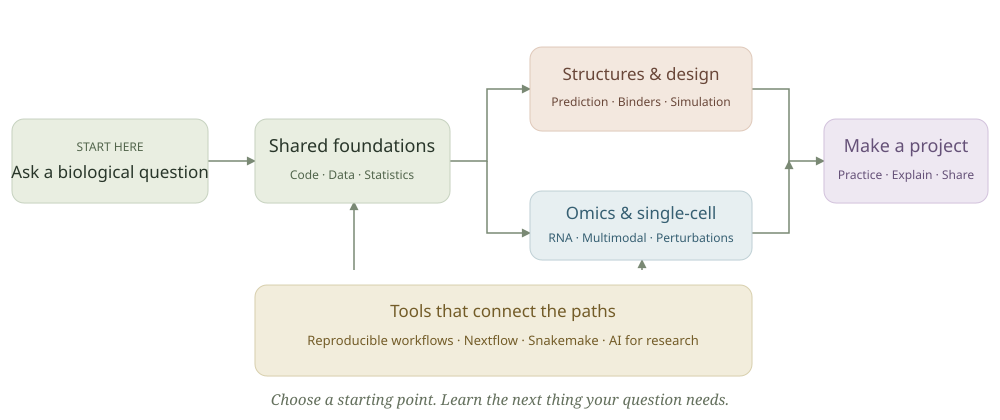

<!-- Generated by scripts/build.py from content/catalog.json. Edit the catalog, then rebuild. -->

# Bioinformatics Resources

A friendly field guide to learning bioinformatics, building reproducible analyses, and exploring modern biological research. Curated by **Ahmed Sameh**.

Start where you are. Choose one question, learn the next skill it needs, and practice with a small project. You do not need to complete every course or master advanced mathematics before beginning.

**[Explore the website](https://ahhmedsamehh.github.io/Bioinformatics_resources/)** · **[Start here](guides/start-here.md)** · **[Browse the resource library](guides/resources.md)** · **[Try a project](projects/README.md)**

The website includes a searchable resource library, learning paths, mobile navigation, and a light/dark mode button that remembers your preference. Its first visit follows your device theme.



## Choose a learning path

| Path | What you can explore |
| --- | --- |
| [Foundations](guides/foundations.md) | Get comfortable with code, biological data, and the questions good analyses ask. |
| [Structures & protein design](guides/structural.md) | Learn to inspect molecular structures, interpret predictions, and explore protein and binder design. |
| [Omics & single-cell](guides/omics.md) | Move from sequencing foundations to single-cell, multimodal, perturbation, and immune repertoire analyses. |
| [Workflows & reproducibility](guides/workflows.md) | Turn a working analysis into a documented, testable workflow with Nextflow or Snakemake. |
| [AI for biological research](guides/ai.md) | Understand biological models, work effectively with LLMs, and build agents whose results you can evaluate. |

The scientific tracks emphasize structural bioinformatics and omics. They are two areas covered by this collection, rather than an exhaustive classification of the field. Workflow development and AI connect across both.

## Learn by doing

- **[Your first RNA-seq comparison](projects/rna-seq/README.md):** Use a small packaged airway count dataset to compare treated and untreated samples while accounting for cell line.
- **[Read your first protein structure](projects/protein-structure/README.md):** Inspect the experimental crambin structure 1CRN and turn its metadata and residue information into a short scientific report.
- **[One analysis, two workflow engines](projects/workflow-basics/README.md):** Calculate sequence GC content with a plain script, then reproduce the same output using Nextflow or Snakemake.

## What makes a resource useful here?

Each topic includes prerequisites, a learning outcome, a practice activity, and interpretation guidance. The **52 annotated resources** include format, level, language, access information, and a reason to use them. Most materials are free to read; software, hosted services, and compute can have separate terms or costs.

Arabic-language programming material is included, and suggestions for more Arabic resources are welcome. Most specialist resources are currently in English.

## About this collection

This repository began as a personal learning list. It aims to make useful starting points available to people entering bioinformatics and to help learners connect foundations with modern research practice. It is a growing guide, not a certification or a complete curriculum for every specialty.

**Collection editorial review:** 2026-10-20. This date does not imply that every external course or workflow was completed or independently validated. Resource versions, availability, access terms, and compute requirements can change.

The [historical list](guides/legacy-resources.md) and existing book folders are retained for continuity. Current recommendations favor author, maintainer, and publisher links. Linked resources retain their own licenses and terms.

## Contribute or build the website

Found a broken link, a misleading explanation, or a resource worth sharing? [Open an issue](https://github.com/Ahhmedsamehh/Bioinformatics_resources/issues/new) or see [CONTRIBUTING.md](CONTRIBUTING.md).

Edit `content/catalog.json` to update topics and resources, then run:

```sh
python3 scripts/build.py
python3 scripts/check.py
python3 -m http.server 8000 --directory _site
```

Open [the local preview](http://localhost:8000). Python 3.9+ is sufficient to build the website; no package installation is needed. The same catalog generates the website and GitHub topic pages.

See [the website guide](site/README.md) for GitHub Pages publishing and theme behavior. Original guide text and code use the [MIT license](LICENSE); linked and third-party materials retain their own terms.
